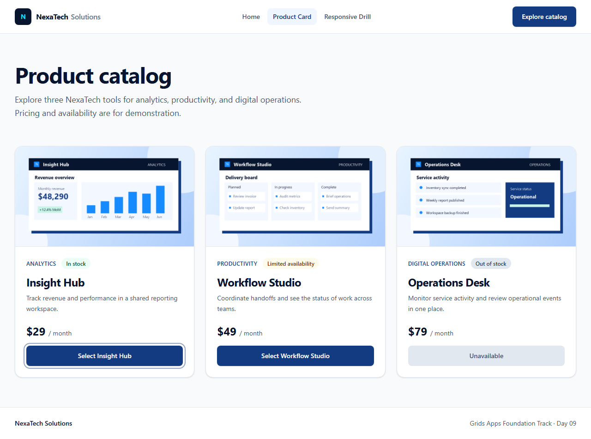
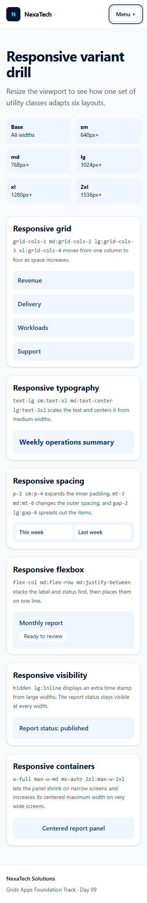

# Grids Apps Internship – Tailwind CSS Training

## Day 09 – Tailwind CSS + Vite Foundations

**Project:** NexaTech Solutions\
**Program:** Full Stack Web Development Internship\
**Track:** Foundation Track

---

## Project Overview

NexaTech Solutions is a modern SaaS website developed as part of the Grids Apps internship.

The project focuses on building responsive, consistent, and accessible user interfaces using Tailwind CSS utilities and the Vite development environment.

## Learning Objectives

- Set up Tailwind CSS using Vite.
- Understand the utility-first approach.
- Apply spacing, typography, color, and layout utilities.
- Build responsive interfaces using mobile-first design.
- Implement reusable UI patterns and interactive states.

## Completed Tasks

### T01 – SaaS Hero

- Responsive split hero section.
- Modern SaaS dashboard preview.
- Primary and secondary CTA buttons.
- Trust indicators.
- Responsive navigation.
- Semantic HTML structure.

### T03 – Product Cards

- Three responsive product cards.
- Product images, descriptions, and prices.
- Product availability badges.
- Consistent card dimensions and spacing.
- Hover, focus, and disabled states.

### Responsive Variant Drill

Implemented six practical demonstrations covering:

- Responsive Grid.
- Responsive Typography.
- Responsive Spacing.
- Responsive Flexbox.
- Responsive Visibility.
- Responsive Containers.

## Technologies Used

- HTML5
- CSS3
- Tailwind CSS v4
- Vanilla JavaScript
- Vite
- Git & GitHub

## Project Pages

| Page | Description |
| --- | --- |
| index.html | SaaS Hero and dashboard preview |
| product-card.html | Responsive product catalog |
| responsive-drill.html | Tailwind responsive utility demonstrations |

## Project Features

- Modern and professional SaaS design.
- Consistent brand identity.
- Mobile-first responsive layouts.
- Tailwind utility-based styling.
- Accessible navigation.
- Interactive UI states.
- Locally stored image assets.

## Getting Started

Install dependencies.

```bash
npm install
```

Start the development server.

```bash
npm run dev
```

Create a production build.

```bash
npm run build
```

Preview the production build.

```bash
npm run preview
```

## Screenshots

### SaaS Hero


### Product Cards



### Responsive Variant Drill


### Mobile Design

| SaaS Hero | Product Cards | Responsive Drill |
| --- | --- | --- |
|  |  |  |

## Testing & Quality Assurance

- Successfully tested the development server.
- Successfully generated the production build.
- Tested all pages across seven different screen widths.
- Verified navigation, images, and responsive layouts.
- Verified keyboard navigation and interactive states.
- Fixed the missing favicon issue.

## Day 09 – Exit Ticket

**What did I build today?**

A responsive SaaS hero, product card components, and responsive utility demonstrations using Tailwind CSS and Vite.

**What bug or difficulty did I solve?**

Resolved a missing favicon issue and verified the website across different screen sizes.

**What concept can I explain clearly?**

The utility-first approach and how mobile-first responsive variants adapt layouts to different screen sizes.

**What remains incomplete?**

Git commits are pending repository author configuration. Additional Tailwind challenges will be completed in the upcoming training days.

## Day 09 Progress

- [x] Tailwind CSS and Vite setup
- [x] T01 – SaaS Hero
- [x] T03 – Product Cards
- [x] Responsive Variant Drill
- [x] Development server verification
- [x] Production build verification
- [x] Responsive testing
- [x] Project documentation
- [ ] Git commits

---

Developed as part of the **Grids Apps Full Stack Web Development Internship – Foundation Track**.
