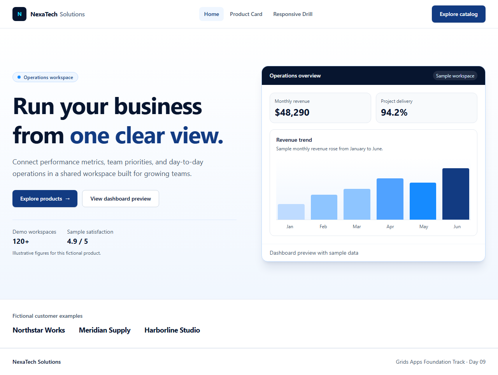
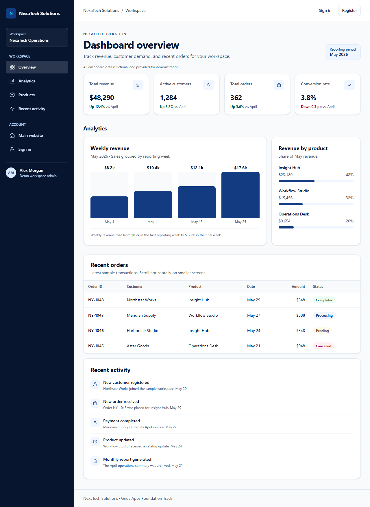
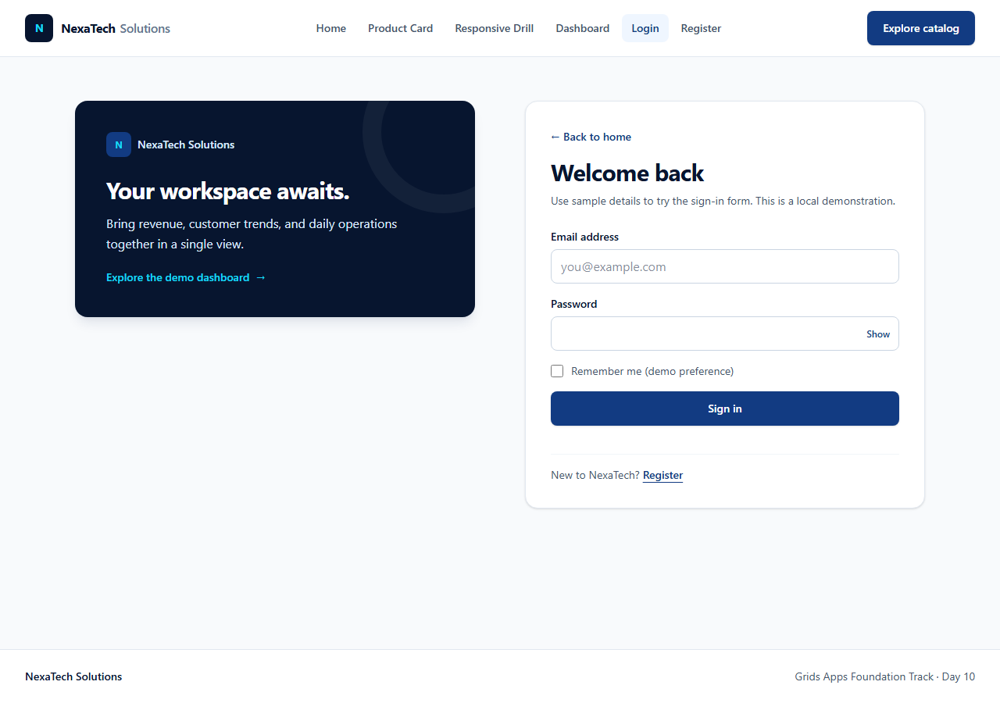
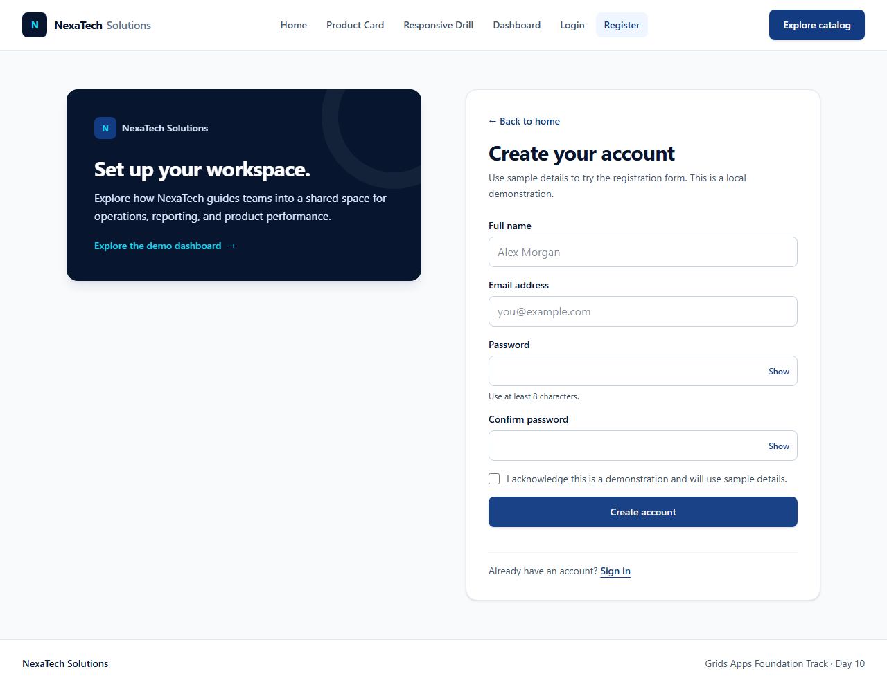
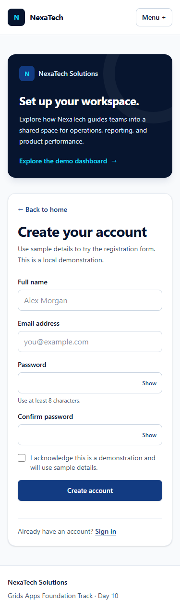

# Grids Apps Internship – Tailwind CSS Training

## Day 09 – Tailwind CSS + Vite Foundations

**Project:** NexaTech Solutions\
**Program:** Full Stack Web Development Internship\
**Track:** Foundation Track

---

## Project Overview

NexaTech Solutions is a modern SaaS website developed as part of the Grids Apps internship.

The project focuses on building responsive, consistent, and accessible user interfaces using Tailwind CSS utilities and the Vite development environment.

## Learning Objectives

- Set up Tailwind CSS using Vite.
- Understand the utility-first approach.
- Apply spacing, typography, color, and layout utilities.
- Build responsive interfaces using mobile-first design.
- Implement reusable UI patterns and interactive states.

## Completed Tasks

### T01 – SaaS Hero

- Responsive split hero section.
- Modern SaaS dashboard preview.
- Primary and secondary CTA buttons.
- Trust indicators.
- Responsive navigation.
- Semantic HTML structure.

### T03 – Product Cards

- Three responsive product cards.
- Product images, descriptions, and prices.
- Product availability badges.
- Consistent card dimensions and spacing.
- Hover, focus, and disabled states.

### Responsive Variant Drill

Implemented six practical demonstrations covering:

- Responsive Grid.
- Responsive Typography.
- Responsive Spacing.
- Responsive Flexbox.
- Responsive Visibility.
- Responsive Containers.

## Technologies Used

- HTML5
- CSS3
- Tailwind CSS v4
- Vanilla JavaScript
- Vite
- Git & GitHub

## Project Pages

| Page | Description |
| --- | --- |
| index.html | SaaS Hero and dashboard preview |
| product-card.html | Responsive product catalog |
| responsive-drill.html | Tailwind responsive utility demonstrations |
| dashboard.html | Admin sidebar, analytics, recent orders, and activity |
| login.html | Demo sign-in form and validation states |
| register.html | Demo registration form and validation states |

## Project Features

- Modern and professional SaaS design.
- Consistent brand identity.
- Mobile-first responsive layouts.
- Tailwind utility-based styling.
- Accessible navigation.
- Interactive UI states.
- Locally stored image assets.

## Getting Started

Install dependencies.

```bash
npm install
```

Start the development server.

```bash
npm run dev
```

Create a production build.

```bash
npm run build
```

Preview the production build.

```bash
npm run preview
```

## Screenshots

### SaaS Hero



### Product Cards


### Responsive Variant Drill


### Mobile Design

| SaaS Hero | Product Cards | Responsive Drill |
| --- | --- | --- |
|  |  |  |

## Testing & Quality Assurance

- Successfully tested the development server.
- Successfully generated the production build.
- Tested all pages across seven different screen widths.
- Verified navigation, images, and responsive layouts.
- Verified keyboard navigation and interactive states.
- Fixed the missing favicon issue.

## Day 09 – Exit Ticket

**What did I build today?**

A responsive SaaS hero, product card components, and responsive utility demonstrations using Tailwind CSS and Vite.

**What bug or difficulty did I solve?**

Resolved a missing favicon issue and verified the website across different screen sizes.

**What concept can I explain clearly?**

The utility-first approach and how mobile-first responsive variants adapt layouts to different screen sizes.

**What remains incomplete?**

Day 09 was committed and pushed to GitHub. Further Tailwind challenges are covered in later training days.

## Day 09 Progress

- [x] Tailwind CSS and Vite setup
- [x] T01 – SaaS Hero
- [x] T03 – Product Cards
- [x] Responsive Variant Drill
- [x] Development server verification
- [x] Production build verification
- [x] Responsive testing
- [x] Project documentation
- [x] Git commit and GitHub push

---

## Day 10 – Tailwind Responsive Components & Dashboard

Day 10 extends NexaTech Solutions with a responsive analytics workspace and two authentication form demos. The dashboard uses fictional data, and the forms validate sample entries locally.

### Learning Objectives

- Use mobile-first breakpoints to adapt navigation, Grid, and Flexbox layouts.
- Build consistent dashboard cards and responsive data displays.
- Use state variants to make hover, focus, errors, and disabled controls clear.

### T04 – Admin Sidebar

The desktop sidebar groups workspace and account links, identifies the active section, and includes a demo profile summary. On mobile and tablet, an expandable menu provides the same links. Escape and section selection close the menu and restore focus to its control.

### T05 – Analytics Dashboard

Four KPI cards display revenue, active customers, orders, and conversion rate. The dashboard also includes a labeled weekly revenue chart, revenue by product, a recent orders table, and an activity list. The KPI grid grows from one column to two at `sm` and four at `xl`. The orders table scrolls within its own keyboard-focusable region on narrow screens.

### Authentication Form States

The login and registration cards demonstrate hover, keyboard focus, checked and disabled controls, and valid and invalid fields. Both forms offer password visibility controls. Registration also checks password confirmation and acknowledgement of the demo terms. Errors appear after a submission attempt, identify the affected input, and clear when corrected. Successful submissions display a demo message and clear the form.

### Accessibility

- Keyboard-operable navigation with visible focus and an active section indicator.
- Form labels, associated error text, and focus on the first invalid field.
- Chart labels with a text summary, semantic table headings, and written status badges.

### Testing & Quality Assurance

- The Vite development server ran successfully. The production build included all six HTML pages, and each opened in production preview.
- Headless Chrome passed all 42 page and viewport combinations at 320, 375, 640, 768, 1024, 1280, and 1536 px. Checks covered navigation, images, responsive layouts, table scrolling, and Day 09 regressions.
- Keyboard checks covered visible focus, Escape, section navigation, and focus restoration. Form checks covered required fields, invalid email, short and mismatched passwords, checkbox validation, password visibility, and successful demo feedback.
- Fixed mobile dashboard focus after section navigation. The final run recorded zero browser console or resource errors.

### Screenshots

#### Dashboard



#### Login



#### Register



#### Mobile Design

| Dashboard | Login | Register |
| --- | --- | --- |
|  |  |  |

### Day 10 Exit Ticket

Draft for student review and personalization.

**What did I build today?**

I built a responsive admin sidebar and analytics dashboard, plus login and registration cards with local validation.

**What bug or difficulty did I solve?**

Selecting a dashboard section from the mobile menu initially cleared keyboard focus. I moved focus restoration after the browser's section jump.

**What concept can I explain clearly?**

I can explain how `sm:grid-cols-2` and `xl:grid-cols-4` adapt the KPI grid, and how `focus-visible:` and `disabled:` style controls based on their state.

**What remains incomplete?**

Day 10 is ready for review before I push it to GitHub. Later challenges and real authentication are outside this exercise.

### Day 10 Progress

- [x] T04 – Admin Sidebar
- [x] T05 – Analytics Dashboard
- [x] Login and registration form states
- [x] Six-page Vite build
- [x] Browser testing and screenshots
- [x] Day 10 documentation
- [ ] Day 10 push after review

---

Developed as part of the **Grids Apps Full Stack Web Development Internship – Foundation Track**.
