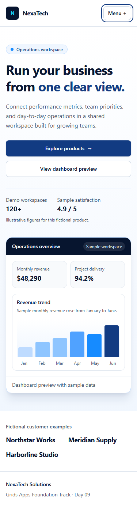
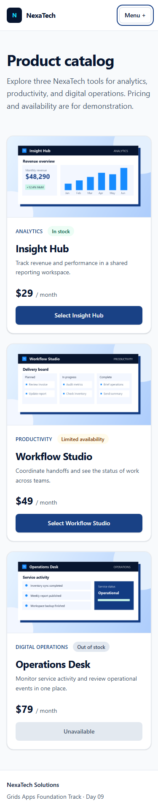
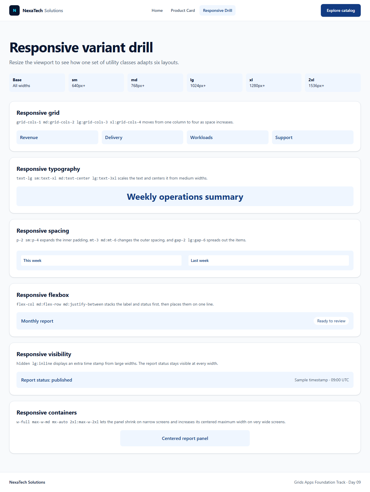
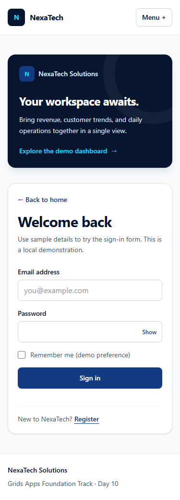
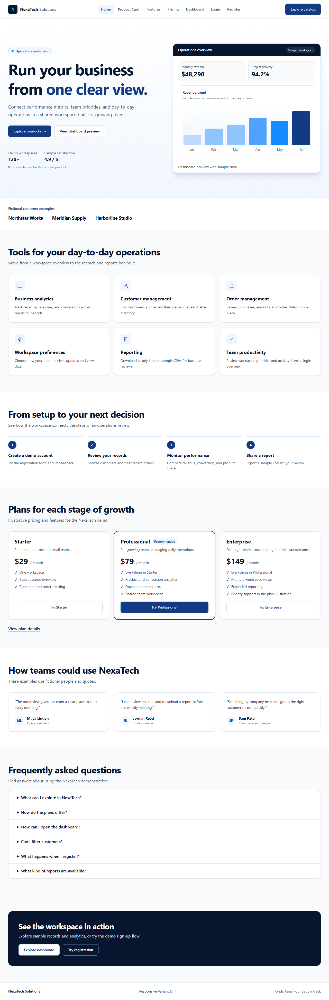
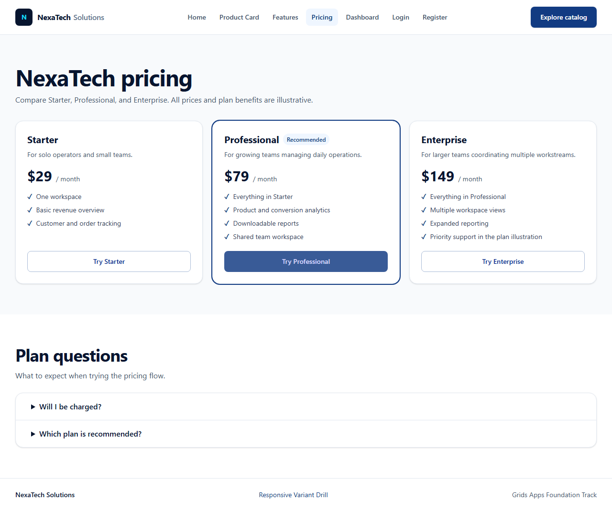
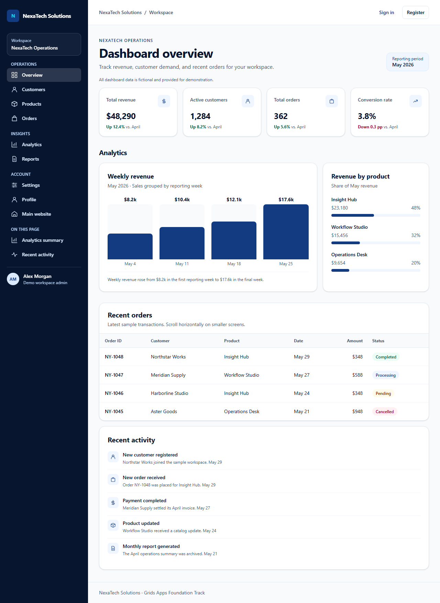
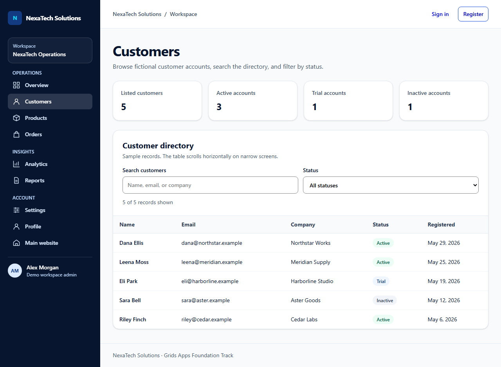

# Grids Apps Internship – Tailwind CSS Training

**Project:** NexaTech Solutions\
**Program:** Full Stack Web Development Internship\
**Track:** Foundation Track

## Project Overview

NexaTech Solutions is a modern SaaS website developed using Tailwind CSS and Vite, focusing on responsive design, reusable UI patterns, accessibility, and consistent branding.

## Technologies Used

- HTML5 & CSS3
- Tailwind CSS v4
- Vanilla JavaScript
- Vite
- Git & GitHub

---

## Day 09 – Tailwind CSS + Vite Foundations

### Completed Tasks

- **T01 – SaaS Hero:** Responsive hero section with CTA buttons, trust indicators, and a dashboard preview.
- **T03 – Product Cards:** Responsive product cards with images, prices, availability badges, and interactive states.
- **Responsive Variant Drill:** Practical demonstrations of Grid, Flexbox, typography, spacing, visibility, and responsive containers.

### Screenshots

**SaaS Hero**




**Product Cards**




**Responsive Variant Drill**




### Exit Ticket

- **What did I build?** Responsive SaaS components using Tailwind CSS and Vite.
- **What difficulty did I solve?** Fixed a missing favicon issue.
- **What did I learn?** Utility-first styling and mobile-first responsive design.
- **What remains incomplete?** Further Tailwind challenges in upcoming training days.

---

## Day 10 – Tailwind Responsive Components & Dashboard

### Learning Objectives

- Responsive Flexbox and Grid layouts.
- Hover, focus, and validation states.
- Consistent and reusable UI patterns.
- Accessible dashboard and form components.

### Completed Tasks

**T04 – Admin Sidebar**

- Professional desktop sidebar.
- Responsive mobile navigation.
- Active navigation states.
- Accessible keyboard interactions.

**T05 – Analytics Dashboard**

- Four KPI cards.
- Revenue analytics and product performance.
- Recent orders table.
- Recent activity list.
- Fully responsive dashboard layout.

**T06 – Authentication Form States**

- Login and registration pages.
- Form validation and error messages.
- Password visibility controls.
- Hover, focus, checked, and disabled states.
- Local demonstration submission feedback.

### Screenshots

**Analytics Dashboard**


**Login Page**




**Registration Page**


### Exit Ticket

- **What did I build?** A responsive analytics dashboard, admin sidebar, and authentication screens.
- **What difficulty did I solve?** Fixed mobile navigation focus restoration.
- **What did I learn?** Responsive layout patterns and Tailwind state variants.
- **What remains incomplete?** Upcoming Tailwind challenges and final project development.

---

## Day 11 – Tailwind SaaS Project Delivery

NexaTech now has 13 connected frontend screens. The project uses fictional business data and local demonstration forms.

### Completed Tasks

- **T07 – SaaS Landing Page.** Preserved the original hero and added six feature cards, a four-step workflow, pricing, fictional testimonials, a keyboard-accessible FAQ, and final dashboard and registration links.
- **T02 – Pricing.** Added Starter, Professional, and Enterprise plans with monthly sample prices. Professional is highlighted, and the cards stack on narrow screens.
- **Dashboard integration.** The overview, customers, orders, analytics, reports, settings, and profile share the responsive sidebar. Products links to the existing catalog.
- **Workspace interactions.** Search and filter customers and orders, read labeled analytics charts, export four sample CSVs, and save settings or profile edits to an on-page preview.
- **T08 – Design-to-Code.** A trainer-supplied mockup is required. The workspace did not contain one.

### Main Project Screens

- **Marketing and training:** [Home](index.html), [Pricing](pricing.html), [Product Catalog](product-card.html), [Responsive Variant Drill](responsive-drill.html).
- **Workspace:** [Overview](dashboard.html), [Customers](customers.html), [Orders](orders.html), [Analytics](analytics.html), [Reports](reports.html), [Settings](settings.html), [Profile](profile.html).
- **Demo account forms:** [Login](login.html), [Register](register.html).

### Selected Screenshots









### Trainer Demo

1. Open Home and show Features, the four-step workflow, and the FAQ. Open Pricing and compare the three plans.
2. Open the Dashboard, shrink to 375 px, and use the menu with Tab, Enter, and Escape.
3. Search for Northstar in Customers and filter Orders by Completed. Compare weekly revenue and product share in Analytics, then download a Revenue CSV in Reports.
4. Save a display preference and edit the demo Profile. Submit Login or Register with incomplete inputs to show validation, then use sample values for successful feedback. Finish by running the production build and opening its preview.

### Day 11 Exit Ticket

Draft for student review and personalization.

- **What did I build today?** I completed the SaaS landing page and pricing, and connected the dashboard to six business screens.
- **What bug or difficulty did I solve?** The sidebar identified the current page in its markup, but the highlight was missing. I corrected the Tailwind state selector and verified the result in Chrome.
- **What concept can I explain clearly?** Mobile-first Grid and Flexbox utilities control layout, while state variants and small JavaScript modules handle navigation, filtering, and form feedback.
- **What remains incomplete?** T08 awaits a trainer-supplied reference. Day 11 is ready for review before pushing.

---

## Getting Started

Install dependencies.

```bash
npm install
```

Run the project.

```bash
npm run dev
```

Create a production build.

```bash
npm run build
```

Preview the build.

```bash
npm run preview
```

## Testing & Quality Assurance

- Day 09 and Day 10 passed the six-page build and 42 viewport checks.
- Day 11 built and served all 13 pages. Headless Chrome passed 91 checks across 320, 375, 640, 768, 1024, 1280, and 1536 px and verified 31 link targets.
- Keyboard checks covered menus, FAQ sections, and scrolling tables. Interaction checks covered the catalog, search and filtering, four CSV downloads, settings and profile feedback, and login and registration validation.
- The final run found zero console or resource errors and captured 11 new screenshots. Browser verification used Chrome.

## Training Progress

- Day 09 – Tailwind CSS + Vite Foundations
- Day 10 – Tailwind Responsive Components & Dashboard
- Day 11 – Tailwind SaaS Project Delivery

---

Developed as part of the **Grids Apps Full Stack Web Development Internship – Foundation Track**.
