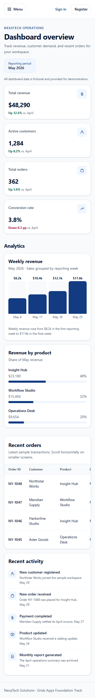

# Grids Apps Internship – Tailwind CSS Training

**Project:** NexaTech Solutions\
**Program:** Full Stack Web Development Internship\
**Track:** Foundation Track

## Project Overview

NexaTech Solutions is a modern SaaS website developed using Tailwind CSS and Vite, focusing on responsive design, reusable UI patterns, accessibility, and consistent branding.

## Technologies Used

- HTML5 & CSS3
- Tailwind CSS v4
- Vanilla JavaScript
- Vite
- Git & GitHub

---

## Day 09 – Tailwind CSS + Vite Foundations

### Completed Tasks

- **T01 – SaaS Hero:** Responsive hero section with CTA buttons, trust indicators, and a dashboard preview.
- **T03 – Product Cards:** Responsive product cards with images, prices, availability badges, and interactive states.
- **Responsive Variant Drill:** Practical demonstrations of Grid, Flexbox, typography, spacing, visibility, and responsive containers.

### Screenshots

**SaaS Hero**


**Product Cards**


**Responsive Variant Drill**


### Exit Ticket

- **What did I build?** Responsive SaaS components using Tailwind CSS and Vite.
- **What difficulty did I solve?** Fixed a missing favicon issue.
- **What did I learn?** Utility-first styling and mobile-first responsive design.
- **What remains incomplete?** Further Tailwind challenges in upcoming training days.

---

## Day 10 – Tailwind Responsive Components & Dashboard

### Learning Objectives

- Responsive Flexbox and Grid layouts.
- Hover, focus, and validation states.
- Consistent and reusable UI patterns.
- Accessible dashboard and form components.

### Completed Tasks

**T04 – Admin Sidebar**

- Professional desktop sidebar.
- Responsive mobile navigation.
- Active navigation states.
- Accessible keyboard interactions.

**T05 – Analytics Dashboard**

- Four KPI cards.
- Revenue analytics and product performance.
- Recent orders table.
- Recent activity list.
- Fully responsive dashboard layout.

**T06 – Authentication Form States**

- Login and registration pages.
- Form validation and error messages.
- Password visibility controls.
- Hover, focus, checked, and disabled states.
- Local demonstration submission feedback.

### Screenshots

**Analytics Dashboard**




**Login Page**


**Registration Page**


### Exit Ticket

- **What did I build?** A responsive analytics dashboard, admin sidebar, and authentication screens.
- **What difficulty did I solve?** Fixed mobile navigation focus restoration.
- **What did I learn?** Responsive layout patterns and Tailwind state variants.
- **What remains incomplete?** Upcoming Tailwind challenges and final project development.

---

## Getting Started

Install dependencies.

```bash
npm install
```

Run the project.

```bash
npm run dev
```

Create a production build.

```bash
npm run build
```

Preview the build.

```bash
npm run preview
```

## Testing & Quality Assurance

- All six pages successfully built and tested.
- Responsive testing across seven screen sizes.
- 42 successful page and viewport checks.
- Keyboard navigation and form validation verified.
- No remaining browser console errors.

## Training Progress

- Day 09 – Tailwind CSS + Vite Foundations
- Day 10 – Tailwind Responsive Components & Dashboard

---

Developed as part of the **Grids Apps Full Stack Web Development Internship – Foundation Track**.
